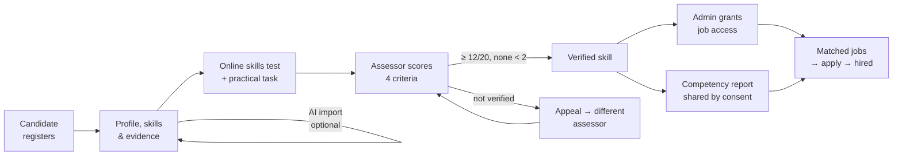
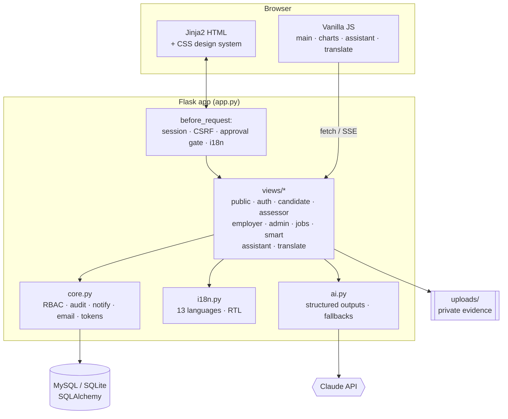

<div align="center">

# SkillProof

**Digital skills recognition and validation for refugees and displaced professionals**

Record skills · back them with evidence · get them independently assessed · share a verified report · get hired


[Quick start](#-quick-start) · [Features](#-features) · [Architecture](#-architecture) · [Documentation](#-documentation) · [Demo](#-demo-accounts) · [Security](#-security--data-protection) · [Deploy](#-deployment)

</div>

---

## Why SkillProof

Millions of refugees arrive with real professional skills: nurses, developers, electricians, teachers. But their
certificates were lost, can't be checked, or aren't recognised. Employers can't tell what they can actually do,
so skilled people end up in informal, low-paid work.

SkillProof closes that trust gap. Candidates **declare** their skills and **back them with evidence**. Vetted assessors then **independently assess** each skill against
published criteria. Candidates share a **verifiable competency report** with employers, only with their consent.
Admins vet employers and assessors and approve job ads to block scams, and grant job access to verified candidates.



---

## ✨ Features

| Area | What it does |
|---|---|
| **Accounts** | 3-step registration wizard, email confirmation, lockout after 5 failed logins, password reset, sign-in history, "sign out everywhere". Employers and assessors wait for admin approval. |
| **Skills profile** | Headline, summary, work history, skills with category, level (1–5) and years. Profile-completeness meter and guided next steps. |
| **Evidence** | Files (PDF, image, Word, zip; up to 10 MB) or links, tied to a skill. Stored outside the web root under random names and served only after a permission check. |
| **AI document import** | Upload a CV, certificate or photo of your work. Claude suggests skills, levels, work history and **corrections** to the profile; the candidate ticks what to keep. Identity documents are refused. |
| **Two-stage assessment** | An auto-marked **online skills test** (AI-written or from a question bank), then a **practical task**. The assessor scores knowledge, practical ability, evidence and communication (0–5 each), with an optional advisory **AI evidence review**. |
| **Appeals** | The candidate appeals with reasons. If the admin upholds it, the skill goes to a *different* assessor. |
| **Competency report** | A premium printable report grouped into **competence areas**, with seal, scorecards, criteria bars and assessment reference codes. Can be shared whole or one area at a time (`/p/<token>?area=Healthcare`). |
| **Employers** | Hiring dashboard, talent search (keyword, category, location, level, verified only), shortlist with private notes. |
| **Jobs** | Admin-approved job ads, **skills-match score** per candidate, applications that move through Applied → Shortlisted → Interview → Offer → Hired. |
| **Admin console** | KPIs with week-over-week trends, growth and funnel charts, user management (bulk actions, CSV), verifications, job access, job approvals, appeals, audit log, settings. |
| **13 languages** | English, Kiswahili, Français, العربية (RTL), Soomaali, Kinyarwanda, Ikirundi, አማርኛ, ትግርኛ, Afaan Oromoo, Lingála, Dholuo, Gĩkũyũ. |
| **Content translation** | One click translates text people wrote (profiles, job ads, feedback, cover notes) into the reader's language. Results are cached per text and language. |
| **AI assistant** | A streaming onboarding chat that answers in the user's language and knows their next step. Works offline in "guide mode". |
| **Themes & devices** | Light / dark / system themes, fully responsive from phone to desktop, print styles, accessible markup, skip links. |

> Every AI feature has a **non-AI fallback**, so the whole platform works without an API key.

---

## 🚀 Quick start

**Requirements:** Python 3.10+ (tested on 3.14). MySQL 8 is optional; SQLite is used by default.

```bash
git clone https://github.com/cjaihub/skillproof.git
cd skillproof
python3 -m venv .venv && source .venv/bin/activate     # Windows: .venv\Scripts\activate
pip install -r requirements.txt
cp .env.example .env                                     # optional: edit settings
python seed.py --reset                                   # demo accounts and data
python app.py                                            # → http://127.0.0.1:5050
```

> Port 5050 is used because macOS AirPlay often takes port 5000.

### Turn on AI features (optional)
Add your key to `.env`. Never commit it.
```bash
ANTHROPIC_API_KEY=sk-ant-...
```
This turns on the AI assistant, document import, AI-written tests, the AI evidence review and content translation.
See [docs/AI.md](docs/AI.md).

### Use MySQL
```bash
mysql -u root -p < schema.sql      # creates the database and user
```
Then set `DATABASE_URL=mysql+pymysql://skillproof:<password>@localhost:3306/skillproof?charset=utf8mb4` in `.env`.
Tables are created automatically on first run.

---

## 🏗 Architecture



| Layer | Choice | Why |
|---|---|---|
| Backend | Flask 3 app factory; one module per area under `views/`, each with `register(app)` | Small and readable; no blueprint boilerplate |
| Data | Flask-SQLAlchemy 3, 18 tables | Same code on SQLite (dev) and MySQL (prod) |
| Frontend | Server-rendered Jinja2 with vanilla JS and dependency-free SVG charts | Fast on low-end phones and poor connections, no build step |
| AI | Anthropic Python SDK, Pydantic structured outputs, streaming over SSE | Typed results and graceful fallback |
| i18n | Gettext-style `_()` with JSON catalogues and English keys | Easy for translators; machine drafts are flagged for review |

More detail: [docs/ARCHITECTURE.md](docs/ARCHITECTURE.md) · [docs/DATA-MODEL.md](docs/DATA-MODEL.md)

---

## 📚 Documentation

| Document | Contents |
|---|---|
| [Architecture](docs/ARCHITECTURE.md) | Request lifecycle, modules, design decisions, frontend |
| [Data model](docs/DATA-MODEL.md) | ER diagram, every table, status lifecycles |
| [Routes & API](docs/API.md) | All 76 endpoints by role, JSON APIs (`/api/assistant`, `/api/translate`) |
| [User guide](docs/USER-GUIDE.md) | Walkthroughs for candidates, assessors, employers and admins |
| [AI features](docs/AI.md) | Models, prompts, structured outputs, fallbacks, privacy, cost |
| [Internationalisation](docs/I18N.md) | Languages, coverage, adding a language, content translation |
| [Security & privacy](docs/SECURITY.md) | Threat model, controls, Kenya Data Protection Act 2019 |
| [Deployment](docs/DEPLOYMENT.md) | Configuration, MySQL, Render/Railway/Fly, production checklist |
| [Testing](docs/TESTING.md) | The end-to-end suite and link crawler |
| [Contributing](CONTRIBUTING.md) | Code style, adding pages and strings, pull requests |

---

## 🎭 Demo accounts

After `python seed.py --reset`, all accounts use the `DEMO_PASSWORD` set in [seed.py](seed.py). In development, the login page
has one-click demo buttons. **Remove the demo data before real use.**

| Role | Email | Try this |
|---|---|---|
| Admin | `admin@skillproof.test` | Dashboard, approve pending accounts, verify identity, job access, approve jobs, appeals |
| Candidate | `amina@skillproof.test` | 3 competence areas, verified skills, shared report, job-ready, applications |
| Candidate | `nyaruach@skillproof.test` | Unverified skill with an open appeal |
| Assessor | `assessor@skillproof.test` | Assessment queue with SLA flags, test results, scoring form |
| Assessor | `assessor2@skillproof.test` | Second assessor, for appeals |
| Employer | `employer@skillproof.test` | Hiring dashboard, talent search, jobs and applicants |
| Employer (pending) | `hiring@greenbuild.test` | Waits on the "awaiting approval" screen |

<details>
<summary><b>5-minute demo script</b></summary>

1. **Register** a new candidate through the 3-step wizard. Without SMTP, the confirmation link appears on screen.
2. **Import with AI**: upload a CV and accept suggested skills and corrections.
3. **Add evidence**, take the **skills test**, answer the **practical task**, then submit for assessment.
4. As **assessor**: open the queue, review test results, optionally run the AI review, then score the 4 criteria and save.
5. As **candidate**: open the **competency report**, give consent, copy the share link, then **request job access**.
6. As **admin**: grant job access and approve a pending job ad.
7. As **candidate**: browse matched **jobs** and apply. As **employer**: move the applicant to *Interview*.
8. Switch language with the globe button. Try **العربية** (right to left), then **Translate** the user-written text.
</details>

---

## 🔐 Security & data protection

Designed around the **Kenya Data Protection Act, 2019** and the needs of vulnerable users:

- Salted password hashes, CSRF on every form and JSON call, HttpOnly and SameSite cookies, security headers
- Role-based access checked on every route; employers and assessors are vetted by an admin
- **Consent before sharing**: off by default, timestamped, can be withdrawn, revocable links
- **Employers never see evidence files**; candidates are told not to upload ID or refugee numbers, and AI import refuses identity documents
- Self-declared and independently assessed results are always shown separately
- Data subject rights: export all my data, see who viewed my data, delete my account (files included)
- Audit log of assessments, role, consent and access changes; rate limits on the AI endpoints

Full details and a production checklist are in [docs/SECURITY.md](docs/SECURITY.md).

---

## ☁️ Deployment

Run the Flask app on **Render, Railway, Fly.io or PythonAnywhere** with a managed MySQL database:

```bash
gunicorn -w 3 -k gthread --threads 4 -b 0.0.0.0:$PORT app:app
```

Netlify only serves static files, so it can't run Flask. See [docs/DEPLOYMENT.md](docs/DEPLOYMENT.md).

---

## 🧪 Tests

```bash
python test_flow.py     # 248 end-to-end checks across every role
```
```bash
python test_links.py    # crawls every page as every role; fails on broken links or 500s
```

---

## 🗂 Project structure

```
app.py                  app factory, session/CSRF/approval gate, security headers
core.py                 access control, audit log, notifications, tokens, email, charts
models.py               SQLAlchemy models, criteria, statuses
ai.py                   Claude calls: document import, evidence review, test generation, matching
i18n.py                 languages, catalogues, coverage, AI translation CLI
views/                  routes per area (public, auth, candidate, assessor, employer,
                        admin, jobs, smart, assistant, translate)
templates/layouts/      public site, auth split-screen, app shell
templates/<area>/       pages per role
templates/_macros.html  icons, badges, KPIs, pagination, language and theme menus
static/css/style.css    design system: tokens, light/dark, RTL, responsive, print
static/js/              main.js · charts.js · assistant.js · translate.js
translations/           <code>.json catalogues (+ <code>.machine.json review lists)
tools/wrap_strings.py   wraps template text in _() for translation
seed.py                 demo data
test_flow.py            end-to-end tests
test_links.py           link crawler
schema.sql              MySQL database and user setup
```

---

## 🛣 Roadmap

- [ ] Native-speaker review of all machine-drafted translations
- [ ] Encrypted object storage for evidence (S3 / GCS)
- [ ] IP-based rate limiting and Redis sessions for multi-instance deployments
- [ ] SMS and WhatsApp notifications for users without regular email access
- [ ] Partner integrations (UNHCR, training providers) for pre-verified credentials
- [ ] Offline-first PWA for camps with patchy connectivity

---

<div align="center">
Built with care for people rebuilding their careers.
</div>
