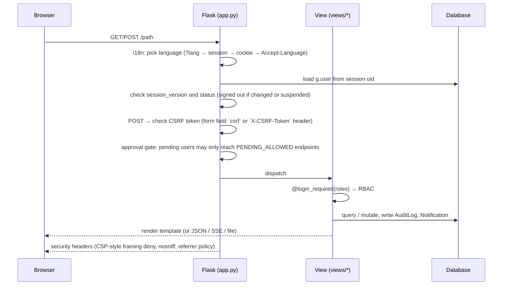

# Architecture

SkillProof is a server-rendered Flask application. It has no separate frontend build and no JavaScript framework. Pages are
Jinja2 templates styled by one CSS design system, with small vanilla-JS modules for interactive parts.
This keeps pages light on low-end Android phones and slow connections, which many users in refugee settings rely on.

## Request lifecycle

## Modules

| File | Responsibility |
|---|---|
| `app.py` | `create_app()` factory and config from env; `_secret_key()` (uses `SECRET_KEY` or writes `.secret_key`); `before_request` hooks; security headers; context processor (sidebar counters); template filters (`date`, `ago`). |
| `core.py` | `login_required(*roles)`, `log()` audit helper, `notify()`, settings store, signed tokens (itsdangerous) for email verification and password reset, `send_email()` (SMTP, or an on-screen dev link), password rules, chart data helpers (`daily_counts`, `cumulative`, `trend`), `paginate`, practical tasks per category. |
| `models.py` | SQLAlchemy models and domain constants (`LEVELS`, `CRITERIA`, `PASS_MARK`, status dictionaries). See [DATA-MODEL.md](DATA-MODEL.md). |
| `ai.py` | All Claude calls except the chat: `import_document`, `review_evidence`, `build_test`, plus the non-AI fallbacks (`basic_extraction`, the question bank) and `match_score`. |
| `i18n.py` | Language registry, catalogue loading, `gettext`, coverage, string extraction and the AI translation CLI. See [I18N.md](I18N.md). |
| `views/public.py` | Home, privacy, public shared report, notifications, account (profile, password, export, delete). |
| `views/auth.py` | Register wizard, login with lockout, logout, verify email, forgot/reset password, pending screen. |
| `views/candidate.py` | Dashboard, profile, experience, skills, evidence, report, consent, appeals, access log. |
| `views/assessor.py` | Queue with SLA flags and the scoring form. |
| `views/employer.py` | Employer dashboard, talent search, talent profile, shortlist. |
| `views/admin.py` | Admin dashboard, users (bulk actions, CSV), verifications, assessments, appeals, audit, settings. |
| `views/smart.py` | AI import flow, skills test, AI evidence review, job-access request and admin decision. |
| `views/jobs.py` | Employer jobs, admin job approval, candidate job board, applications. |
| `views/assistant.py` | `/api/assistant`: streaming chat (SSE) with offline guide mode. |
| `views/translate.py` | `/api/translate`: cached translation of user-written content. |

Each view module has a `register(app)` function that defines its routes with `@app.route`. Endpoint names are flat
(`url_for('skills')`), so templates stay simple.

## Key design decisions

- **Self-declared and assessed results are kept separate.** A `Skill` starts as `self_declared` and only becomes `verified`
  through an `Assessment` by someone other than its owner. Reports and search show the two kinds of result separately.
- **Pass rule:** 12 or more out of 20 across the four criteria, with **no criterion below 2**. A strong score in one criterion can't hide a gap in another.
- **Appeals go to someone new.** When an appeal is upheld, the skill goes back to the queue and the original assessor is blocked from it.
- **Sessions can be revoked.** `User.session_version` is stored in the session. Changing the password, "sign out everywhere"
  or suspension bumps it, which ends every other session.
- **AI is advisory and optional.** Every AI feature returns a typed Pydantic object, has a non-AI fallback, and
  never makes a decision without a person: assessors copy suggested scores only if they agree, and candidates tick which imports to keep.
- **No build step.** CSS custom properties drive light, dark, RTL and print styles; charts are hand-written SVG
  (`static/js/charts.js`), so there are no chart libraries.

## Frontend

| File | Contents |
|---|---|
| `static/css/style.css` | Design tokens (colour, space, radius, shadow), light and dark themes, RTL mirroring (`[dir=rtl]`, `.flip-rtl`), layouts (public, auth split-screen, app shell with sidebar), components (panels, KPIs, badges, pills, tables, toasts, wizard, tour), the premium report (`.report-x`, `rx-*`), assistant widget, translation bar, print styles. |
| `static/js/main.js` | Theme switching (`localStorage['sp-theme']`), dropdowns, toasts, registration wizard, password strength meter, bulk select, live score preview, the "how it works" tour, copy-to-clipboard. |
| `static/js/charts.js` | `data-chart` attributes become line, bar and donut SVG charts. |
| `static/js/assistant.js` | Chat UI that reads Server-Sent Events from `/api/assistant`. |
| `static/js/translate.js` | Finds `[data-tr]` elements, batches them to `/api/translate`, toggles original/translated, remembers auto-translate per language. |

The theme is applied by an inline script in `base.html` **before first paint**, so there is no light/dark flash.
