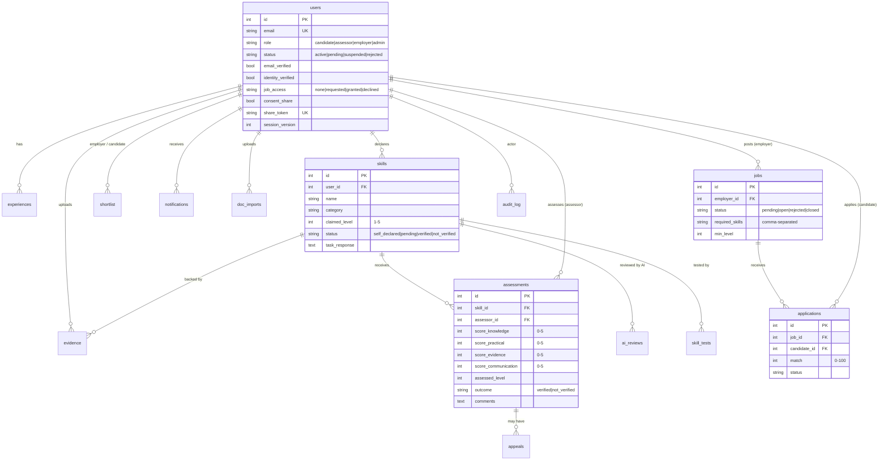
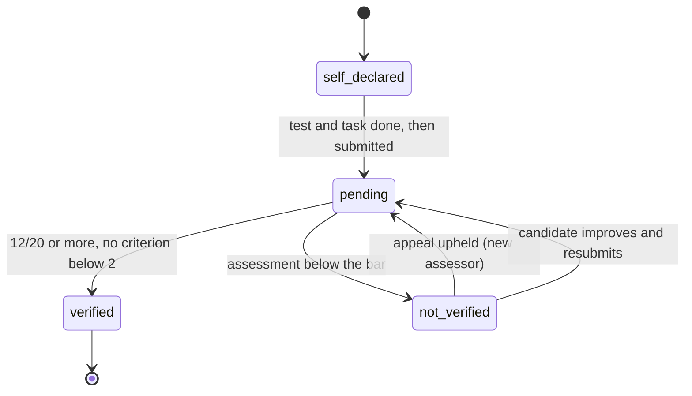

# Data model

The models are defined in [`models.py`](../models.py) using Flask-SQLAlchemy. The same models run on SQLite and MySQL (`utf8mb4`).
Tables are created automatically on start-up (`db.create_all()`). There are no migrations yet: after a schema change, run
`python seed.py --reset` (development) or recreate the database.

## Entity–relationship diagram

## Tables

| Table | Purpose | Notes |
|---|---|---|
| `users` | Every account, any role | Security fields: `failed_logins`, `locked_until`, `session_version`, `last_login_at`. Sharing: `consent_share`, `consent_at`, `share_token`. |
| `experiences` | Work history | `end_year` empty means current job. |
| `skills` | A declared skill | `requested_at` drives SLA flags in the assessor queue. |
| `evidence` | File or link | `stored_name` is random; the original filename is only shown, never used as a path. |
| `assessments` | One assessor's decision | `reference` property gives `SP-YYYY-NNNNN`, quoted on reports. |
| `appeals` | Candidate challenge | `open`, `upheld` or `rejected`; `resolution` text is required. |
| `shortlist` | Employer's saved candidates | Unique per employer–candidate pair; private note. |
| `notifications` | In-app messages | `link` opens the right page through `/n/<id>`. |
| `doc_imports` | AI or basic import result | `result_json` holds the suggestions until applied or discarded. |
| `ai_reviews` | AI evidence review for assessors | Advisory only; stores the model used. |
| `skill_tests` | Online skills test | Correct answers live server-side in `questions_json`; `mcq_score / mcq_total`. |
| `jobs` | Job ads | Need admin approval (`pending` → `open`). |
| `applications` | Candidate → job | `match` is stored when the candidate applies. |
| `content_translations` | Cache for `/api/translate` | Key is (`source_hash` SHA-256, `lang`). |
| `settings` | Admin-editable switches | Key–value store. |
| `audit_log` | Who did what | `actor_id`, `action`, `subject_user_id`, `detail`, `ip`. |

## Lifecycles

### Skill

### Account
`pending` (employers and assessors after registering) → `active` once an admin approves, or `rejected`. Any account can be
`suspended` and reactivated. Candidates are `active` straight away but must confirm their email before key actions.

### Job access
`none` → `requested` (candidate has a verified skill, confirmed email, 70%+ profile and sharing on) → `granted` or `declined` by an admin.

### Job and application
- Job: `pending` → `open` (admin approves) or `rejected` → `closed`.
- Application: `applied` → `shortlisted` → `interview` → `offer` → `hired`, or `rejected` / `withdrawn` at any point.

## Domain constants

| Constant | Value |
|---|---|
| `LEVELS` | 1 Beginner · 2 Basic · 3 Competent · 4 Proficient · 5 Expert |
| `CRITERIA` | knowledge · practical · evidence · communication (0–5 each) |
| `PASS_MARK` | 12 out of 20, plus no criterion below 2 |
| Categories | Software development, IT support & networking, Healthcare, Teaching & training, Trades & vocational, Business & finance, Other. Each has a practical task in `core.PRACTICAL_TASKS`. |
